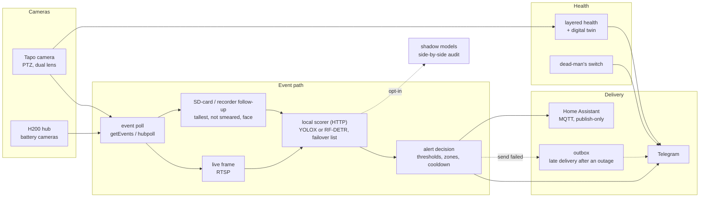

# tapo-monitoring

[](https://github.com/PeterkoCZ91/tapo-monitoring/actions/workflows/ci.yml)
[](https://www.python.org/)
[](https://github.com/PeterkoCZ91/tapo-monitoring/blob/main/LICENSE)

**Tapo alerts where the photo actually shows the person.** Tapo cameras like to report
*motion detected* with a picture of an empty driveway: by the time the snapshot is taken, the
person has walked out of frame. tapo-monitor is a self-hosted Python daemon that listens to the
camera's own detection events, finds the frame the person is really in and sends that one to
Telegram (and, if you want, to Home Assistant over MQTT).

- **The right photo** — if the live frame is empty, it reads the camera's own SD-card recording
  around the event and picks the frame where the person appears tallest, skips frames smeared by a
  pan/tilt swing, and can prefer one that shows a face.
- **Fewer false alarms** — an optional local scorer (YOLOX, or RF-DETR) checks every photo for a
  person before it is sent. In a week-long test on live cameras RF-DETR Medium 896 found 46 of 68
  people with 6 false alarms, the YOLOX default 25 with 45
  ([detector comparison](docs/measurements.md#a-week-of-shadow-scoring-on-live-cameras)).
  It runs on a CPU; nothing has to leave your network.
- **It keeps working, and says when it doesn't** — alerts lost to an outage are delivered
  later, camera and service health is watched, and a dead-man's switch reports a silent daemon.
- **Light** — no continuous video decoding; a Raspberry Pi runs the daemon. Not a Frigate
  replacement: the opposite trade-off.

> **Project status:** the core daemon and alert pipeline are operational and validated on
> the C560WS, and the `hubpoll` battery-camera path is validated end to end against real
> hub-backed hardware. The Camera Digital Twin (layered health, drift and allow-listed
> self-healing) and the Shadow Detection Auditor run in production behind opt-in flags; a
> nightly recorder scan measures camera miss candidates. Camera models and firmware differ;
> unsupported capabilities degrade to `unknown` instead of being guessed.

> **New here?** Go straight to **[Getting started](docs/getting-started.md)** — one camera,
> person detection, Telegram, in about ten minutes. Read [credentials](docs/credentials.md)
> first; it is the step most people get wrong.

> **Questions, ideas or another Tapo model?** Join the
> [Home Assistant Community thread](https://community.home-assistant.io/t/tapo-monitor-tapo-alerts-where-the-photo-actually-shows-the-person-with-home-assistant-over-mqtt/1028479).

## Tested cameras

| Camera | How it is used | Notes |
| --- | --- | --- |
| C560WS | reference model, runs the whole pipeline | `event_profile: default` |
| TC46 | `getEvents` with an SD card | `event_profile: default`; same getters and event bits as the C560WS; [anonymized report](https://github.com/PeterkoCZ91/tapo-monitoring/blob/main/tests/fixtures/cameras/tc46-1.1.10.json) |
| C216 | SD event index, RTSP snapshots and ONVIF PTZ tested in the lab | firmware 1.3.2; sampled events use `event_profile: default` as motion candidates; automatic SD rescue and tracking safety remain open; see [model notes](docs/c216.md) and the [anonymized report](tests/fixtures/cameras/c216-1.3.2.json) |
| C260 | `getEvents` with an SD card | `event_profile: default`; [anonymized report](https://github.com/PeterkoCZ91/tapo-monitoring/blob/main/tests/fixtures/cameras/c260-1.2.3.json) |
| C545D (dual lens) | `getEvents` with an SD card, per-lens RTSP streams | needs `event_profile: c545d`; see [dual-lens cameras](https://github.com/PeterkoCZ91/tapo-monitoring/blob/main/docs/configuration.md#dual-lens-cameras-c545d) |
| C410 / C460 on an H200 hub | `hubpoll` reads detections off the hub | see [battery cameras on a hub](https://github.com/PeterkoCZ91/tapo-monitoring/blob/main/docs/battery-cameras-on-a-hub.md) |

Other Tapo models with third-party access and `getEvents` may work; what we learned about
the local API across models is in the [local API reference](https://github.com/PeterkoCZ91/tapo-monitoring/blob/main/docs/tapo-local-api.md).
Own a model not listed here? Run `tapo-monitor report` and share the anonymized file:
see [camera reports](https://github.com/PeterkoCZ91/tapo-monitoring/blob/main/docs/camera-reports.md).

## What's new

**0.12.0** adds opt-in event sources for card-less Tapo cameras (`lastalarm`) and Reolink
cameras (`reolink`), a short video clip as a reply to each alert photo (`clip_video`,
`clip_url`) and quieter scorer outage notices; **0.11.0** connects to cameras that switched to the newer TPAP login (pytapo 3.4.28)
and stops re-logging in every minute after an auth failure; **0.10.2** keeps a clip from going out unscored when one frame failed during a scorer
switch; **0.10.1** stops one walk from alerting twice when the camera reports its person
event late. **0.10.0:** the follow-up photo skips frames smeared by a pan/tilt swing and can prefer one
that shows a face, card reads retry on a fresh login, follow-up scoring no longer floods
slow uplinks, and the scorer gets a thread budget for CPUs. A week-long comparison of four
detectors on live cameras is in the [measurements](docs/measurements.md#a-week-of-shadow-scoring-on-live-cameras).

Earlier highlights — an optional outbox delivers alerts lost to an internet outage once
Telegram is back (English or Czech texts), and the TC46 joins the tested cameras. Compare
up to four shadow detectors, each optionally rate-limited, without changing live alerts,
review individual model boxes and missed-person candidates, and use optional scorer
failover or watch-zone, loitering and vehicle policies. Native-resolution crops keep small
subjects visible; unscored sampler alerts are marked for review. Home Assistant over MQTT,
dual-lens C545D support, off/privacy notices and incident-based labeling remain available. Full per-version
detail and upgrade notes are in the
[CHANGELOG](https://github.com/PeterkoCZ91/tapo-monitoring/blob/main/CHANGELOG.md).
For existing installations, [Upgrading to 0.10.0](docs/upgrading.md) lists changed
defaults, optional features and the scorer-first deployment sequence.

## Why this project exists

[`pytapo`](https://github.com/JurajNyiri/pytapo) provides camera API operations.
[`HomeAssistant-Tapo-Control`](https://github.com/JurajNyiri/HomeAssistant-Tapo-Control)
exposes a broad Tapo feature set in Home Assistant. [Frigate](https://github.com/blakeblackshear/frigate)
is a complete local AI NVR. This project occupies a narrower space:

- run on modest hardware without requiring continuous local video inference;
- use the camera's on-device AI as the primary event source;
- encode Tapo-specific reliability knowledge such as login lockouts, sequential requests,
  SmartTrack ordering and SD recording freshness;
- treat an alert as successful only after the notification is delivered;
- distinguish network, API, events, RTSP and storage failures;
- measure desired configuration drift and, nightly, camera detection misses.

It is not a full NVR, video-management UI or replacement for Frigate. An optional local
recorder and scorer can complement the daemon, but neither is required for the basic flow.

## Highlights

- **One fleet daemon** — multiple cameras, one validated YAML configuration and one state
  machine per camera.
- **Low-login event polling** — `getEvents` is polled every few seconds on an existing
  session while reconnect/control runs on a slower interval.
- **Firmware-safe camera control** — day/night policy, people-only SmartTrack, presets,
  rain gating, sensitivity control and optional ONVIF soft pan limits.
- **Opt-in optics & camera policy** — on-sensor Lens Distortion Correction (LDC)
  straightens wide-angle 4K frames for sharper peripheral YOLO scoring, tamper monitoring
  is self-healed every control pass, and white floodlight activation duration scales down
  to polite 30 s pulses instead of the 5-minute firmware default.
- **On-device face intelligence** — `learn-face` CLI helper captures on-device face enrollment
  events, and `faces.ignore_known` quiets alerts for familiar household members.
- **Reliable event media** — live RTSP first, then an event-time SD-card or local-recorder
  follow-up when the first frame misses the subject; the subject zoom can be cropped from
  a native-resolution grab so a distant figure stays legible. The follow-up photo can be
  the frame where the person is tallest, skips frames smeared by a pan/tilt swing, and can
  prefer one that shows a face ([frame pick](docs/configuration.md#live-sd-and-local-recorder-media)).
- **Alert video clips (opt-in)** — `clip_video` sends a short H.264 clip of the incident as
  a reply to its alert photo, read from the camera card or from an HTTP recorder
  ([guide](docs/alert-clips.md)).
- **Battery cameras on a hub** — `hubpoll` reads a sleeping camera's detections off the
  hub it records to; with a scorer, the sharpest accepted frame is selected from the
  stored clip. A go2rtc sidecar supplies a live fallback when the clip cannot be decoded.
- **Optional HTTP scorer** — YOLOX or a supported DETR-family model gates frames and
  returns subject boxes; Groq remains optional caption enrichment. Scorer failover and
  up to four independent shadow targets are opt-in; shadow results leave live decisions
  unchanged unless you separately enable the experimental ensemble policy.
- **Confirmed Telegram semantics** — failed sends do not arm cooldowns; recovery, SD and
  sampler paths remain retryable.
- **It tells you when it stops working** — a dead-man's switch outside the main loop
  reports a daemon whose every tick is failing, because silence otherwise looks exactly
  like a quiet night.
- **Event-API watchdog** — separates `getEvents` failures from network reachability, reports
  recovery and can request one bounded API reboot per failure episode.
- **Daily fleet heartbeat** — one digest a day says the fleet is alive: cameras, tick,
  scorer, recorder, alert counts. It claims OK only for what it checked, and any failed
  check removes the headline.
- **Verifiable deploys** — releases ship as fingerprinted directories behind a symlink, so
  rollback is re-pointing the link; an opt-in localhost-first JSON status endpoint answers
  "how is this host doing" without log parsing.
- **Camera Digital Twin** — redacted safe-getter snapshots, desired/actual drift and
  layered health without a second login loop.
- **Shadow Detection Auditor** — a private, media-free SQLite ledger correlates camera
  events with independent scorer/recorder observations.
- **One owner for the motor** — preset recalls and the pan-limit guard ask one arbiter
  before moving, so the guard never fights a tracked subject or a lens parked by privacy
  mode.
- **Restart-safe, traceable alerts** — pending media work and cooldown state survive a
  deploy. Enable the optional [outbox](docs/configuration.md#outbox-late-delivery-after-an-outage)
  to retain failed Telegram deliveries for bounded late delivery; it is off by default.
  Every alert carries an incident ID you can follow with `tapo-monitor incident`, and
  `tapo-monitor replay` checks a config change against recorded events before it ships.
- **Watch zones, loitering and vehicles (opt-in)** — count only people standing inside
  polygons you draw, get one "someone is lingering" notice, and optionally alert on
  vehicles the scorer sees; see the
  [guide](https://github.com/PeterkoCZ91/tapo-monitoring/blob/main/docs/watch-zones.md).
- **Thresholds from your own frames, not guesswork** — a collector keeps every host's
  sent and held frames beyond their retention, a larger teacher model labels the frames
  it and the scorer agree on, and a local page shows you only the disagreements. On the
  first pilot pass this turned 815 frames into 86 clicks, and showed that most frames
  held back for corroboration were real people — the kind of finding a threshold tweak
  by feel never produces.

See the complete [capability catalog](https://github.com/PeterkoCZ91/tapo-monitoring/blob/main/docs/capabilities.md) and
[architecture](https://github.com/PeterkoCZ91/tapo-monitoring/blob/main/docs/architecture.md).

## Quick start

> First time? The step-by-step **[Getting started](docs/getting-started.md)** guide walks
> this through to your first alert, and [credentials](docs/credentials.md) explains the
> camera accounts. The summary below assumes you have those in hand.

Requirements: Python 3.10+, `ffmpeg`, a supported Tapo camera with third-party access, and
camera/RTSP credentials created in the Tapo app (see [credentials](docs/credentials.md)).

Home Assistant OS: tapo-monitor is a standalone service, not an integration or App. Run it
on a separate Linux host (a Raspberry Pi 4 is enough) and connect it to your broker over
[MQTT](#home-assistant-mqtt); Container, Supervised and Core installs can run it on the
same machine.

Install the released package from PyPI (add extras as needed: `[mqtt]` for Home
Assistant, `[scorer]` for the local scorer, `[onvif]` for the pan limit):

```bash
python3 -m venv ~/tapo-monitor/.venv
source ~/tapo-monitor/.venv/bin/activate
pip install tapo-monitor            # or: pip install 'tapo-monitor[mqtt]'

curl -fsSLo cameras.yaml \
  https://raw.githubusercontent.com/PeterkoCZ91/tapo-monitoring/main/cameras.minimal.yaml
$EDITOR cameras.yaml
```

Start from `cameras.minimal.yaml` (one camera, person detection, Telegram) and grow into
`cameras.example.yaml`, the fully annotated reference, once it works.

For development, work from a clone instead:

```bash
git clone https://github.com/PeterkoCZ91/tapo-monitoring.git
cd tapo-monitoring

python3 -m venv .venv
source .venv/bin/activate
pip install -e ".[dev]"

cp cameras.example.yaml cameras.yaml
$EDITOR cameras.yaml
```

Then, either way:

```bash

export TELEGRAM_TOKEN=...
export TELEGRAM_CHAT_ID=...
export CAM_USER=...
export CAM_PASSWORD=...
export CAM_RTSP_USER=...
export CAM_RTSP_PASSWORD=...

tapo-monitor check cameras.yaml
tapo-monitor run cameras.yaml
```

Prefer containers? `docker compose` with the shipped `Dockerfile`,
`docker-compose.example.yml` and `tapo.env.example` gets the same daemon running without a
local Python setup, on amd64 or a 64-bit Raspberry Pi — see [Docker](https://github.com/PeterkoCZ91/tapo-monitoring/blob/main/docs/docker.md).

The YAML contains environment-variable **names**, never secret values. `cameras.yaml`,
`.env` files and runtime media are git-ignored. Start from the
[configuration guide](https://github.com/PeterkoCZ91/tapo-monitoring/blob/main/docs/configuration.md), not by enabling every optional feature.

## Architecture at a glance



An event takes the left-to-right path: the camera reports it, the daemon grabs a live frame
and, when that misses the person, frames from the camera's own recording; the scorer checks
each candidate and the decision sends the best one. Groq captions are optional. The fast
event path and the slower control/reconnect path are intentionally separate. A camera that
is pingable can still have a broken API, stale events or failed RTSP, so those layers are
observed independently. See [Architecture](https://github.com/PeterkoCZ91/tapo-monitoring/blob/main/docs/architecture.md) for timing,
failure containment and persistence.

## Event decision flow

1. Poll `getEvents` and decode the firmware's `events_1` bitmask.
2. Treat a camera-confirmed person differently from bare motion.
3. Capture a live RTSP frame and optionally score it locally.
4. If a confirmed event's frame is empty, queue an event-aligned SD/recorder follow-up.
5. Optionally crop and caption the chosen frame.
6. Send Telegram and advance cooldown state only after confirmed delivery.
7. Record the branch in the structured audit stream and optional private ledger.

This separation matters: a camera event says that something happened, not that the first
available frame contains the subject.

## CLI

| Command | Purpose |
| --- | --- |
| `tapo-monitor check [cameras.yaml]` | Validate configuration and print the fleet summary. |
| `tapo-monitor version` | Release plus a fingerprint of the deployed module set. |
| `tapo-monitor selfcheck [cameras.yaml]` | Can this host run? Imports, config, credential env vars, `ffmpeg`. |
| `tapo-monitor run [cameras.yaml]` | Start the daemon. |
| `tapo-monitor status [health.json]` | Inspect observed uptime, outages and reconnects offline. |
| `tapo-monitor audit-log [logfile\|-]` | Summarize event/scorer/Telegram audit records. |
| `tapo-monitor twin-status [twin.json] [--json]` | Inspect layered health and config drift offline. |
| `tapo-monitor probe [cameras.yaml] [--camera N] [--json]` | Probe cameras now; opens its own authenticated session. |
| `tapo-monitor report --host IP [--out FILE] [--watch S] [--rtsp]` | Anonymized, shareable report of what your camera model answers; see [camera reports](https://github.com/PeterkoCZ91/tapo-monitoring/blob/main/docs/camera-reports.md). |
| `tapo-monitor shadow-record ...` | Ingest one independent media-free observation. |
| `tapo-monitor shadow-report ...` | Correlate camera and shadow observations. |
| `tapo-monitor shadow-scan ...` | Nightly recorder audit: re-score yesterday's segments for miss candidates. |
| `tapo-monitor incident <camera>-<start>` | Everything recorded for one incident: ledger rows and sent-log frames (read-only). |
| `tapo-monitor replay cameras.yaml ...` | Replay a recorded ledger window through the alert gates and recorded SD/sampler/hub deliveries (read-only); `--compare` a candidate config or threshold, `--scene-reach` to measure the scene gate. |
| `tapo-monitor label <dataset_dir> [--port 8791] [--bind 127.0.0.1]` | Label collected sent/review-log frames in a local web page; verdicts go to `labels.jsonl`. |
| `tapo-monitor label-stats <dataset_dir> [--config cameras.yaml] [--json]` | False-alarm rate, misses and the best-separating threshold from the labels; per incident: missed visits and the delay to the first alert by delivery path; with `--config`, split by day and night. |
| `tapo-monitor autolabel <dataset_dir> --model yolox_x.onnx` | A larger teacher model auto-labels frames it and the scorer agree on; the page then shows only disagreements. |

## Optional local scorer

Install scorer dependencies and run the stateless HTTP service on the same host or a
stronger machine:

```bash
pip install 'tapo-monitor[scorer]'   # from a clone: pip install -e ".[scorer]"
python -m tapo_monitor.scorer_service --model /path/to/model.onnx --port 8766
```

Then set the camera's `scorer.url`. When scoring is unavailable, camera-confirmed alerts
can still pass through. With `scorer.on_error: hold` (the default), a sampler group that
already has low-scored frames waits for later frames rather than spending its alert on
an unscored frame, until its last scheduled frame. `open` restores unconditional
passthrough for that case. An unscored sampler send is marked `(unverified)` and audited
as degraded. See [scorer failures](docs/operations.md#when-the-scorer-itself-fails).
The configured threshold gates on **person** confidence; animal confidence never sends an
alert by itself, but a confident animal score marks the caption with a paw so a dog walker
is not indistinguishable from a lone figure. Tiled inference and optional subject cropping
help with distant subjects in wide views. The scorer also exposes
aggregate-only runtime counters at `/metrics` for operational monitoring.

The service can require a shared bearer token, run a DETR-family detector instead of
YOLOX, feed up to four independent shadow services, or use the first shadow in an
experimental ensemble. A camera's `scorer.url` may list interchangeable services with
failover and return to the primary. These features are opt-in; shadow comparisons do
not select a winning model or switch the production detector automatically. Setup and
model validation are described in
[Operations](https://github.com/PeterkoCZ91/tapo-monitoring/blob/main/docs/operations.md#provision-the-scorer).

Two opt-in calibration aids help tune thresholds by frame rather than by guesswork: an
archive of every photo sent to Telegram (`TAPO_SENT_LOG_DIR`, self-pruning) and
`python -m tapo_monitor.scene_probe`, which scores a live frame internally without alerting.
See [Operations](https://github.com/PeterkoCZ91/tapo-monitoring/blob/main/docs/operations.md#inspecting-alert-frames). To calibrate from ground
truth, `tools/collect_frames.sh` gathers every host's frames into one dataset,
`tapo-monitor autolabel` pre-labels the easy ones with a larger teacher model and
`tapo-monitor label` serves the rest on a local page; `label-stats` then reports the
false-alarm rate, the misses and the best-separating threshold, by day and night with
`--config`, and per incident how many visits with a person got no alert and how late the
first alert came on each delivery path ([Labeling](https://github.com/PeterkoCZ91/tapo-monitoring/blob/main/docs/labeling.md)).

For detector comparisons, [build a labeling set from two to four shadow logs](docs/operations.md#build-a-labeling-set-from-two-to-four-shadow-targets).
Selection includes small-person, missed-person and control samples, can use surviving
sent/review-log images, and skips existing human labels. Frames with box metadata enable
[box review](docs/labeling.md#box-labels-opt-in): mark each model box or draw a person it
missed. Per-model recall counts only the models recorded as having run on that frame;
the sample supports manual evaluation, not an automatic model promotion.

**Which detector?** A week of shadow scoring on nine live camera streams, with the 350
frames where the models disagreed labeled by hand, put RF-DETR Medium at 896 px clearly
ahead: on the 198 frames all four models saw it found 46 of 68 people with 6 false alarms
in 130 empty frames, against 25 and 45 for the YOLOX-m 640 default. It is now on trial
on one camera, so the default does not change yet. Numbers, threshold sweep and limits:
[detector comparison](docs/measurements.md#a-week-of-shadow-scoring-on-live-cameras).
On a CPU, match `TAPO_SCORER_THREADS` to the CPUs the service gets, and consider an INT8
copy of YOLOX-m ([Running the scorer on a CPU](docs/operations.md#running-the-scorer-on-a-cpu)).

## Home Assistant (MQTT)

An opt-in, publish-only MQTT bridge announces every camera to Home Assistant through MQTT
discovery: person and motion binary sensors, reachability, privacy mode, "detection off",
twin health and the last alert's time and score, plus the daemon's own availability.
Alert photos are published only with `publish_images: true`. Install the extra and add
the block:

```bash
pip install 'tapo-monitor[mqtt]'
```

```yaml
mqtt:
  host: broker.example.org
  user_env: MQTT_USER
  password_env: MQTT_PASSWORD
```

The bridge runs on its own thread with a bounded queue, so a slow or unreachable broker
never delays an alert. Entities, topics and an example automation:
[docs/mqtt.md](https://github.com/PeterkoCZ91/tapo-monitoring/blob/main/docs/mqtt.md).
Questions and setups from other Home Assistant users are welcome in the
[community thread](https://community.home-assistant.io/t/tapo-monitor-tapo-alerts-where-the-photo-actually-shows-the-person-with-home-assistant-over-mqtt/1028479).

## Safety and privacy

- No credentials, coordinates, camera addresses or face mappings belong in the repository.
- Runtime state is stored under the XDG state directory with private file permissions.
- Digital Twin snapshots are recursively redacted and use a fixed safe-getter allow-list.
- The Shadow ledger stores timestamps and normalized metadata, never frames or stream URLs.
- Siren, floodlight and speaker actuators are intentionally not implemented.
- Repeated authentication failures use backoff because affected firmware can lock out the
  source address.

Do not run multiple camera-control integrations against the same device unless you
understand the session and sequential-request limitations.

## Documentation

| Document | Start here when… |
| --- | --- |
| [Documentation index](https://github.com/PeterkoCZ91/tapo-monitoring/blob/main/docs/README.md) | You want a map of all public docs. |
| [Getting started](https://github.com/PeterkoCZ91/tapo-monitoring/blob/main/docs/getting-started.md) | You are new and want your first alert fast. |
| [Credentials](https://github.com/PeterkoCZ91/tapo-monitoring/blob/main/docs/credentials.md) | You are setting up the camera accounts (read before first run). |
| [Configuration](https://github.com/PeterkoCZ91/tapo-monitoring/blob/main/docs/configuration.md) | You are preparing `cameras.yaml` and environment variables. |
| [Architecture](https://github.com/PeterkoCZ91/tapo-monitoring/blob/main/docs/architecture.md) | You want component boundaries, timing and failure semantics. |
| [Operations](https://github.com/PeterkoCZ91/tapo-monitoring/blob/main/docs/operations.md) | You are deploying, monitoring or calibrating a live instance. |
| [Docker](https://github.com/PeterkoCZ91/tapo-monitoring/blob/main/docs/docker.md) | You want to run the monitor (and optional scorer) in containers. |
| [Capabilities](https://github.com/PeterkoCZ91/tapo-monitoring/blob/main/docs/capabilities.md) | You need the implemented/planned feature inventory. |
| [Observability](https://github.com/PeterkoCZ91/tapo-monitoring/blob/main/docs/observability.md) | You are enabling Digital Twin or Shadow Auditor. |
| [MQTT and Home Assistant](https://github.com/PeterkoCZ91/tapo-monitoring/blob/main/docs/mqtt.md) | You want the cameras as Home Assistant entities. |
| [Watch zones](https://github.com/PeterkoCZ91/tapo-monitoring/blob/main/docs/watch-zones.md) | You want alerts only for a yard, a lingering-person notice or vehicle alerts. |
| [Labeling](https://github.com/PeterkoCZ91/tapo-monitoring/blob/main/docs/labeling.md) | You want ground truth for collected alert frames. |
| [Measurements](https://github.com/PeterkoCZ91/tapo-monitoring/blob/main/docs/measurements.md) | You want real accuracy, miss and first-alert latency figures, and how to measure your own. |
| [Troubleshooting](https://github.com/PeterkoCZ91/tapo-monitoring/blob/main/docs/troubleshooting.md) | You hit authentication, RTSP, SD or firmware-specific problems. |
| [`events_1` bitmask](https://github.com/PeterkoCZ91/tapo-monitoring/blob/main/docs/events1-bitmask.md) | Your firmware returns incomplete event types. |
| [Local API reference](https://github.com/PeterkoCZ91/tapo-monitoring/blob/main/docs/tapo-local-api.md) | You call the camera's local API yourself: conventions, error codes, SD card, events, calls to avoid. |
| [Roadmap](https://github.com/PeterkoCZ91/tapo-monitoring/blob/main/docs/roadmap.md) | You want current gaps and planned product phases. |

## Development

```bash
pytest -q
ruff check .
```

Pure planning, classification, drift, matching and persistence logic is tested without
camera hardware; I/O collaborators are injected in tests. CI runs tests and Ruff on
Python 3.12 and 3.13 (the versions the fleet runs; `requires-python` stays 3.10+) for
every push to `main` and every pull request.

See [Contributing](https://github.com/PeterkoCZ91/tapo-monitoring/blob/main/CONTRIBUTING.md), [Security](https://github.com/PeterkoCZ91/tapo-monitoring/blob/main/SECURITY.md), the [changelog](https://github.com/PeterkoCZ91/tapo-monitoring/blob/main/CHANGELOG.md)
and the [MIT license](https://github.com/PeterkoCZ91/tapo-monitoring/blob/main/LICENSE).
